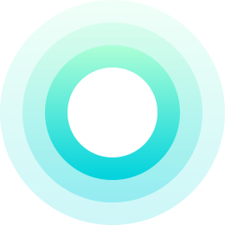
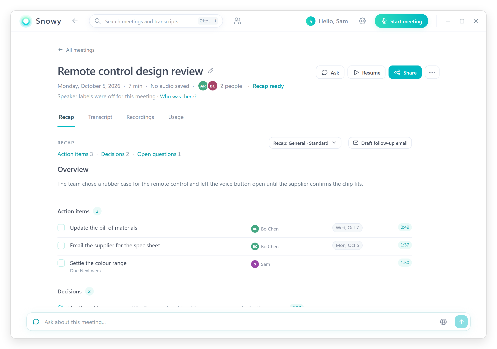
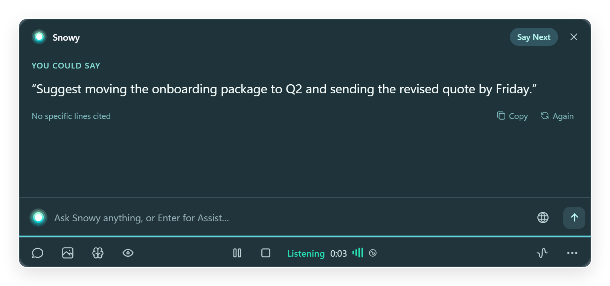
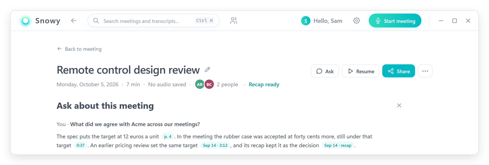

  

<h1 align="center">Snowy</h1>

  <b>A quiet meeting companion for Mac and Windows.</b> 
  Help when you ask for it, a clear recap when the meeting ends, and your audio transcribed on your own computer.

  
  
  

 

## Download

Pick the one for your computer. The download starts straight away and is always the newest version.

| Your computer | Download |
| :-- | :-- |
| **Mac** with an Apple chip (M1, M2, M3, M4) | **[Download for Mac (Apple chip)](https://github.com/snowballmoney/snowy-releases/releases/latest/download/Snowy-Mac-Apple-Silicon.dmg)** |
| **Mac** with an Intel processor | **[Download for Mac (Intel)](https://github.com/snowballmoney/snowy-releases/releases/latest/download/Snowy-Mac-Intel.dmg)** |
| **Windows** 10 or 11 | **[Download for Windows](https://github.com/snowballmoney/snowy-releases/releases/latest/download/Snowy-Windows-Setup.exe)** |

**Which Mac do I have?** Open the Apple menu in the top-left corner of your screen and choose **About This Mac**. If it says **Chip: Apple M1** (or M2, M3, M4), take the Apple chip download. If it says **Processor: Intel**, take the Intel one.

 

## A look inside

  <picture>
    <source media="(prefers-color-scheme: dark)" srcset="assets/recap-dark.png">
    
  </picture>
   
  The recap, written when the meeting ends.

  
   
  Say Next during a call: one line you could say, from what was just said.

  <picture>
    <source media="(prefers-color-scheme: dark)" srcset="assets/brain-dark.png">
    
  </picture>
   
  Snowy Brain: an answer across your meetings and documents, each fact with its source.

 

## What Snowy does

**Live help, when you ask**
- **Say Next** suggests what you could say next, from what was just said.
- **Assist** sums up where the conversation stands and what to ask next.
- **Ask anything** about the meeting, and see the lines each answer comes from.
- **Your screen**, only when you turn on the eye, so a typed question can include it.

**Recaps**
- Written when the meeting ends: the overview, decisions, action items with owner and due date, and open questions.
- Made for the kind of meeting: General, Sales call, 1:1, Interview, Stand-up or Lecture, or a type of your own.
- Brief, Standard or Detailed. Edit any line, tick off action items, assign owners.
- Share it: copy it, save it as a file or PDF, or draft a follow-up email to the people invited.

**Snowy Brain**
- Ask across all your meetings: what was decided on a given day, what someone said, what you owe or were promised.
- A short brief before your next meeting, from your calendar and past meetings.
- A knowledge base (beta): add PDF, Word, PowerPoint, text or Markdown files, and answers cite the page.

**People**
- Everyone from your meetings and invitations in one place, with company, role and your own notes.
- After a meeting, name who spoke with one tap per voice, and the recap says who decided what.
- Speaker labels (beta, off by default) tell the voices on the other side apart.

**Calendar**
- Connect Google Calendar (read-only) to see your day beside your meetings.
- Join & start opens the call and starts Snowy with the meeting's title and invitees.

**The AI you choose**
- Sign in with a ChatGPT Plus or Pro plan, or use a Claude Pro or Max plan through Claude Code.
- Or bring a key for OpenRouter, OpenAI, Anthropic, Gemini, Grok, Mistral, Groq or DeepSeek.
- Or run a model on your own computer with Ollama.

**Connected apps**
- With one click, let ChatGPT (Codex), Claude Desktop, VS Code, Cursor, LM Studio or Hermes search your recaps. Off by default, read-only, on this computer.

 

## Your privacy

- **Your audio stays on your computer.** Speech is transcribed on your computer, and recordings, if you keep them, are saved there.
- **Your meetings live on your computer.** Transcripts, recaps, People and documents are stored there. There is no Snowy account and no usage tracking.
- **What goes to your AI.** When you ask for help or a recap, the text it needs (the transcript and the notes that matter) goes to the AI provider you picked, with your own plan or key. With a model on your computer, nothing leaves it.
- **Only what you allow.** Your screen goes only when you turn on the eye. Web research, if you turn it on, sends only the search words to the search.
- **Some things never go to the AI:** your notes about people, and the email addresses of the people invited.
- **Connected apps see recaps only:** titles, dates, recaps and names. Never transcripts, documents, your notes about people, email addresses or phone numbers.
- **Keys and sign-ins** are kept in your computer's secure storage: Keychain on a Mac, Credential Manager on Windows.

 

## Requirements

- **Mac:** macOS 13 or later, on an Apple chip or Intel. Hearing the other side of a call needs macOS 14.2 or later.
- **Windows:** Windows 10 or 11.
- **Disk and memory:** about 630 MB for the speech model, downloaded at the first start. With 8 GB of memory or more, Snowy uses its more accurate speech model.
- **An AI provider** for live help and recaps. Without one, meetings are still recorded and transcribed.

 

## Install

**On a Mac**
1. Open the file you downloaded (`Snowy-Mac-….dmg`) from your **Downloads** folder.
2. Drag the **Snowy** icon onto the **Applications** folder.
3. Open **Snowy** from Applications, or press ⌘ Space and type *Snowy*. The app is signed and notarized by Apple.
4. The first time you start a meeting, your Mac asks to allow the **Microphone** and **System Audio Recording**. Allow both, so Snowy hears you and the other people on the call.

**On Windows**
1. Open the file you downloaded (`Snowy-Windows-Setup.exe`) from your **Downloads** folder.
2. If a blue box says **"Windows protected your PC"**, choose **More info**, then **Run anyway**. The installer isn't code-signed yet; it is safe to continue.
3. Follow the installer. Snowy opens when it is done.

**Updates**
Snowy looks for a new version every hour and when your computer wakes. When one is ready, a notice offers **Update** or **Later**, and nothing restarts during a meeting.

 

## Links

- **[Changelog](CHANGELOG.md)**: what changed in each release.
- **[All releases](https://github.com/snowballmoney/snowy-releases/releases)**: older versions, release notes and file checksums.
- **Found a bug or have an idea? [Open an issue](https://github.com/snowballmoney/snowy-releases/issues)**, and tell us what you were doing and what you saw.

This repository hosts Snowy's installers and release notes; there is no code here.

 

Made by Snowball

